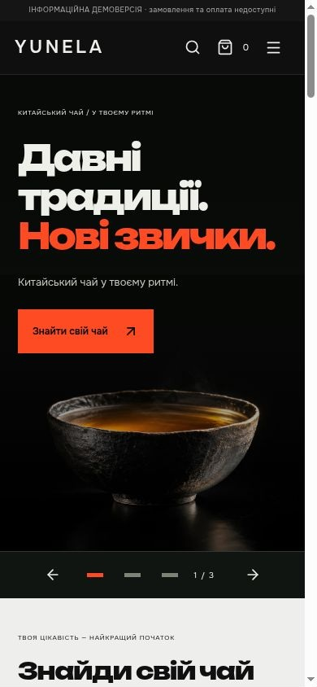
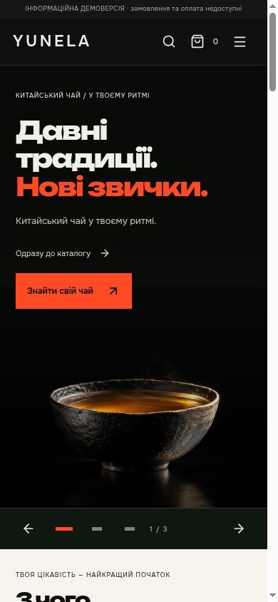
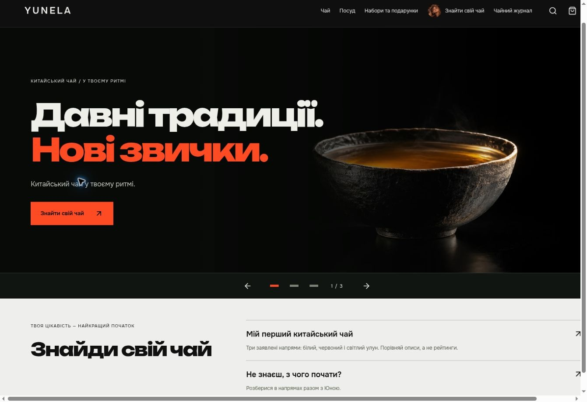
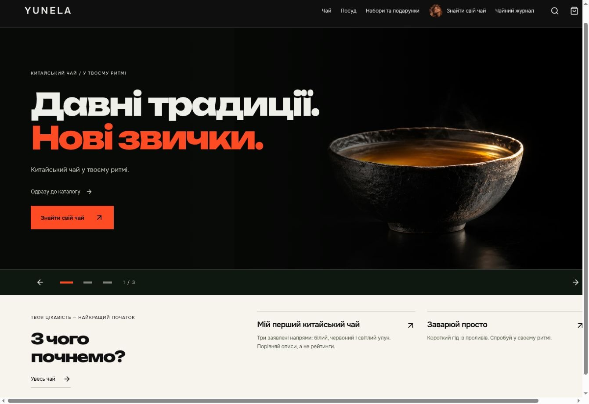
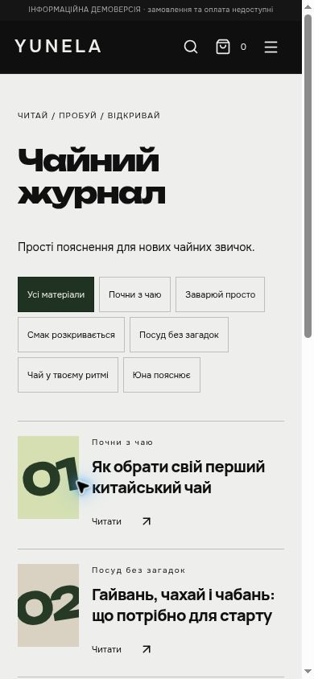
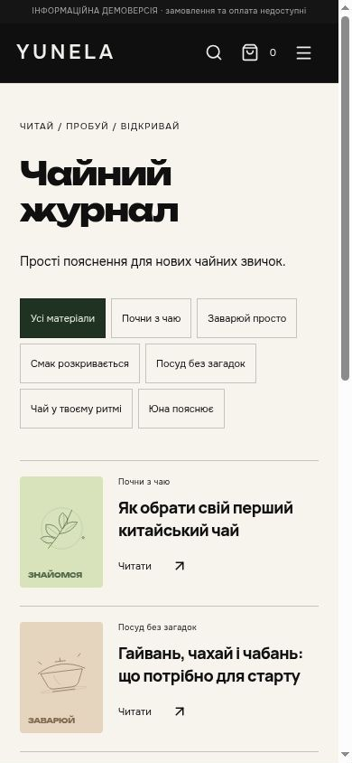
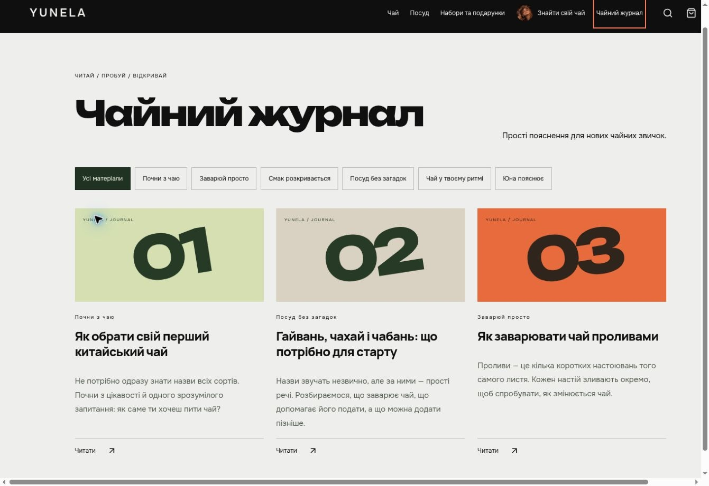
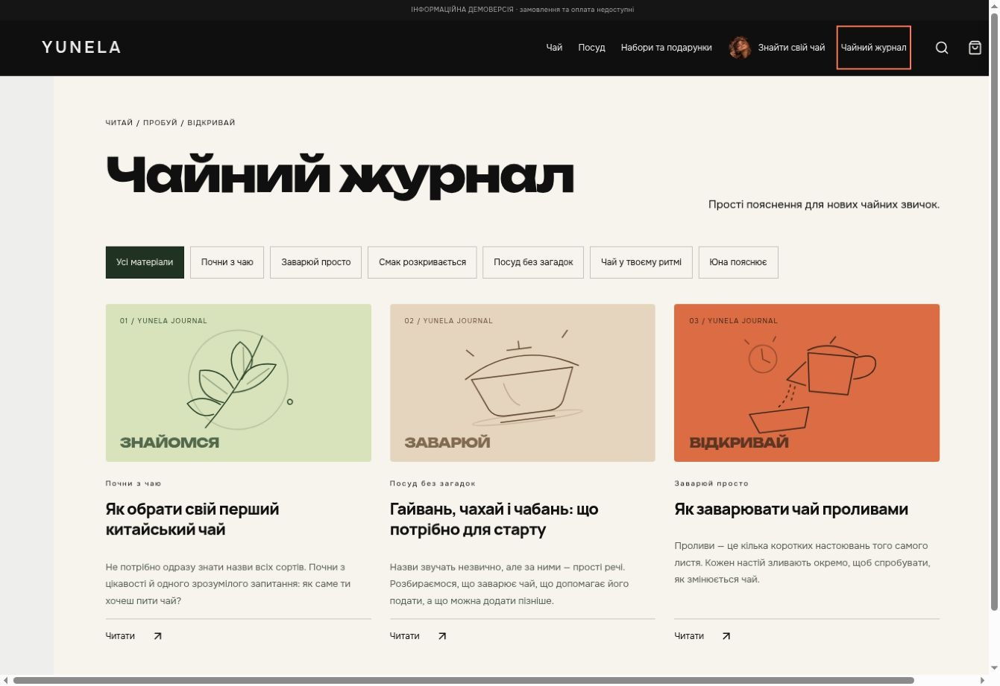

# Task19 — visual polish

Date2026-10-30 Europe/Kyiv. Remote staging HEAD **8cba8002c7b49b87a9c265543d58dde55fbb0a8a**, live baseline **7cc3019a121863540532c7e034c9a85ab74a8256**, tree **3f6c568cb2b9e8ae2d3e976807a734b91346ecc8**. HANDOFF and historical DEVELOPER_HANDOFF_LATEST read; old image-batch stop applies to that image operation, not this explicitly authorized frontend task. No AGENTS.md found. Existing Task18 checkout clean; isolated worktree yunela-task19 / feat/task-19-visual. Task16 not merged.

## Before: actual live site

Fresh browser captures and measurements taken before editing: real same-origin CSS frames390×844 and1440×1000. Baseline bundle index-HfbLf5tq.js. Main sequence banner/discovery/catalog/directions/journal confirmed. Catalog height3674.56px on390 and3992.14px on1440 for12 initial cards; home lacked a separate brand/help ending. Journal covers were large numbers; articles had no related-story links or direct existing-tea links. Native1440px complete screenshot remains unavailable with the browser API; captures show the visible portion of the actual1440px frame.

## Visual changes and why

- Fixed banner track height620mobile /560desktop: switching cannot change the rail's layout height. Existing hero tea image and original Yuna face retained; oolong uses existing approved LIST022 image with editorial-illustration caption. One prominent Yuna introduction, no repeated portraits across page sections.
- Added immediate catalog link, tightened discovery, four-column desktop/two-column mobile catalog, consistent imagery ratios and readable card hierarchy. Initial12 and load-more behavior unchanged.
- Sage/peach editorial panels for teaware and gifts; neutral original SVG gift/gaiwan/leaf/pour graphics are not photos or sellable goods. Full preparation structure retained.
- Topic covers replace numeric placeholders; narrower article body, collapsed contents, one existing practical paragraph emphasized per article, links to the other2 articles and2 actual source records. Article facts/recipe values unchanged.
- Compact brand/help section closes the page; footer title no longer repeats the hero. Yuna assistant reused. Small hover/tap/menu/slide feedback with reduced-motion overrides, no autoplay or video generation.
- Product detail separates brewing recipe grams from future sale packaging; prices/weight rules are not changed or invented. Static demo remains read-only.

## Preliminary checks

TypeScript, ESLint,272tests, image validation56/347 and static client/server production build PASS. Logs in evidence/task19. Проверки выполнены до публикации; результаты приёмки опубликованной версии приведены ниже.

## Scope and next data

Unchanged catalog source, prices, SKU, images, HOLD/ILLUSTRATIVE contracts, commercial/server logic, dependencies, Render configuration and Yuna avatar files. No paid resources, backend, real orders, payments or supplier messages. Noindex retained. Supplier requirements unchanged from TASK_18_CONTENT_MAP.md: actual teaware SKU/material/volume/size/photo rights/stock/cost; set contents and packaging; CEO contacts/return/payment decisions. Preparing overviews remain preparing.

## Подтверждённая публикация и приёмка

**Published code: 31e5c8b490f08182435278dabb6b105ec23662d2**. Render deploy **dep-dbi88agae00c73bgfab0** — LIVE 30.10.2026 13:49:29 Europe/Kyiv. Основной адрес: https://yunela-v92-demo.onrender.com/. Сервис тот же static srv-dbej0rjncjis73edf2h0, auto-deploy off. JS **index-BWIKrdAW.js**, CSS **index-74xgXqux.css**, robots **noindex,nofollow,noarchive**. Tree **986071ddf10ab8476db7ba5c939b688109d84916**. Сначала опубликована основная визуальная сборка55a350ad086df046b8ef811977dabda1c1de5715, затем исправлены пробел в desktop-заголовке каталога и размер mobile-подписи ILLUSTRATIVE с8 до10px. Финальные снимки ниже сделаны на31e5c8b, а не на промежуточной сборке.

После возобновления сессии незакоммиченные предыдущие снимки Task19 недоступны; повторно получены финальные снимки. Для «до» использованы уже сохранённые в GitHub снимки Task18 на7cc3019a121863540532c7e034c9a85ab74a8256. Исходные код и логи проверок восстановлены из фактически опубликованной GitHub-ветки, посторонние рабочие каталоги не включены.

| Сценарий | Ожидание | Фактический результат | Статус |
|---|---|---|---|
| Главная целиком | Единый ритм, быстрый каталог | Баннер → короткий выбор →12 карточек →2 направления →3 статьи →бренд/помощь; верх/каталог/низ просмотрены отдельно | PASS |
| Три баннера /390 и1440 | Читаемый текст, правильные CTA, высота постоянна | Стрелки/точки/Enter работают; улуны дают12 записей, Юна открывает текущего помощника; rail678/620px, track620/560px соответственно | PASS |
| Финальные косметические исправления | Раздельные слова, подпись читаема | «Обирай із цікавості.» подтверждено на1440; подпись иллюстрации10px на390 | PASS |
| Мобильное меню /desktop навигация | Доступные переходы |9 ссылок; Enter открывает, Escape закрывает, видимый фокус; desktop ссылки действуют | PASS |
| Каталог | Удобнее сканировать |2 колонки на390 /4 на1440,12 исходных карточек и прежняя кнопка продолжения; понятные названия и sourceSku | PASS |
| Карточка чая | Фото, рецепт и статус различимы | LIST014 на390 и LIST001 на1440; галерея загружена; статус информационной карточки и пояснение о граммах для заваривания | PASS |
| Цена/фасовка в публичной карточке | Без выдуманных чисел | Публикация коммерческих данных остаётся закрытой базовым static-режимом; отображается честное пояснение | BLOCKED (действующий коммерческий gate) |
| Посуд и подарки | Иллюстрации, понятные направления, честный статус |8 направлений посуды и подготовленные подпункты;4 подарочных направления и3 концепции. Без цены, пустой товарной сетки и покупки | PASS |
| Три статьи | Обложки, удобная ширина, практический совет | first-tea/teaware-start/gongfu открыты; body720px наdesktop,1 исходный абзац выделен как совет;2 связанные статьи и2 реальных чая | PASS |
| Статья → чай → назад | Сохранить контекст | Из gongfu открыт существующий чай; «Назад до статті» возвращает статью | PASS |
| Юна | Сохранить лицо и помощника | Аватар и диалог работают; один заметный портрет в баннере, блок бренда без повторного портрета | PASS |
| Изображения/console | Нет битых изображений и ошибок приложения | Видимые галереи loaded=true; brokenImages=[] во всех сохранённых наблюдениях; HTTPS app console errors=[] | PASS |
|390×844 и1440×1000 CSS viewport | Нет горизонтального переполнения внутри приложения | Измерены innerWidth390/1440; scrollWidth375/1425 после загрузки (полоса прокрутки15px) | PASS (CSS iframe viewport) |
| Полный нативный1440 screenshot | Внешнее окно1440px целиком | Изменение внешнего viewport недоступно; повторная попытка fullPage: Page.captureScreenshot timed out | BLOCKED |
| Touch /эмуляция reduced-motion | Проверка реальным вводом/режимом | Touch и media-emulation API отсутствуют; native scroll-snap и CSS reduced-motion проверены по коду, автопрокрутки нет | BLOCKED (аппаратная/режимная проверка); PASS (реализация) |
| Полная сеть запросов | Network trace | API трассировки недоступен; console и image validation не выдаются за полный network trace | BLOCKED |
| Коммерческий заказ | Остаётся выключенным | Backend/API/checkout не включались, Task16 PAUSED | BLOCKED вне рамокTask19 |

272/272 теста,41 файл — PASS. TypeScript, ESLint без lint-предупреждений, image validation56/347, production client/server build — PASS. Последние2 CSS/пробельные правки повторно прошли TypeScript/ESLint/build с image validation; полный набор272 относится к основной функционально идентичной сборке. [Логи](evidence/task19/), [браузерные измерения](evidence/task19/final.json), [scope](evidence/task19/scope.json). Повторный diff относительно8cba800 подтвердил неизменность public/creative, public/catalog, public/yuna, исходника Юны, src/data, src/application, src/api, content/journal, demo-catalog, package/package-lock, render.yaml и src/yuna.

### Измеримое изменение каталога

Сравниваются те же12 начальных карточек, **не высота всей главной**:

| CSS width | Task18 | Task19 | Сокращение |
|---|---:|---:|---:|
|390 |3674.56px |2819.72px |23.3% |
|1440 |3992.14px |2015.17px |49.5% |

### До / после

«До» — сохранённый Task18 live7cc3019; «после» — финальный Task19 live31e5c8b. Для1440 показана видимая часть настоящего1440px CSS layout; это не полный native1440 screenshot.

| Вид | До | После |
|---|---|---|
| Главная390 | | |
| Главная1440 | | |
| Журнал390 | | |
| Журнал1440 | | |

Метод: unlinked noindex fixtures `/qa/task19-390.html` и `/qa/task19-1440.html` загружают настоящее приложение `/index.html` в same-origin iframe. Это реальные390/1440 CSS px, не ресайз картинки или подмена другой шириной. Mobile JPEG обрезаны по390×844 без масштабирования. Desktop JPEG — доступная часть1341×921/1363×936 внешнего окна; внешнее горизонтальное прокручивание fixture не означает overflow приложения. Скриншоты отдельных страниц фиксируют их верхнюю/доступную часть, а не целую длинную страницу.

### Остальные финальные снимки

**390 CSS px**

- [390-article](evidence/task19/task19-final-390-article.jpg)
- [390-banner2](evidence/task19/task19-final-390-banner2.jpg)
- [390-banner3](evidence/task19/task19-final-390-banner3.jpg)
- [390-catalog](evidence/task19/task19-final-390-catalog.jpg)
- [390-gifts](evidence/task19/task19-final-390-gifts.jpg)
- [390-home-lower](evidence/task19/task19-final-390-home-lower.jpg)
- [390-home](evidence/task19/task19-final-390-home.jpg)
- [390-journal](evidence/task19/task19-final-390-journal.jpg)
- [390-menu](evidence/task19/task19-final-390-menu.jpg)
- [390-product](evidence/task19/task19-final-390-product.jpg)
- [390-teaware](evidence/task19/task19-final-390-teaware.jpg)
- [390-yuna](evidence/task19/task19-final-390-yuna.jpg)

**1440 CSS px**

- [1440-article-teaware](evidence/task19/task19-final-1440-article-teaware.jpg)
- [1440-article](evidence/task19/task19-final-1440-article.jpg)
- [1440-banner2](evidence/task19/task19-final-1440-banner2.jpg)
- [1440-banner3](evidence/task19/task19-final-1440-banner3.jpg)
- [1440-catalog](evidence/task19/task19-final-1440-catalog.jpg)
- [1440-gifts](evidence/task19/task19-final-1440-gifts.jpg)
- [1440-home-lower](evidence/task19/task19-final-1440-home-lower.jpg)
- [1440-home](evidence/task19/task19-final-1440-home.jpg)
- [1440-journal](evidence/task19/task19-final-1440-journal.jpg)
- [1440-product](evidence/task19/task19-final-1440-product.jpg)
- [1440-teaware](evidence/task19/task19-final-1440-teaware.jpg)
- [1440-yuna](evidence/task19/task19-final-1440-yuna.jpg)

Открытых технических FAIL в доступной приёмке не осталось. Блокировки выше не скрыты и не считаются PASS. Эта запись и screenshots — documentation-only follow-up после опубликованного кода; повторный деплой не нужен. До коммерческого запуска остаются действующие LAUNCH_BLOCKERS. Для наполнения поставщиком нужны SKU, материалы, объёмы/размеры, подтверждённые фотографии/права, остатки/цены и состав/упаковка наборов; подробнее TASK_18_CONTENT_MAP.md. Task16 остаётся на паузе; новые платные ресурсы и AI-сервисы не создавались.
